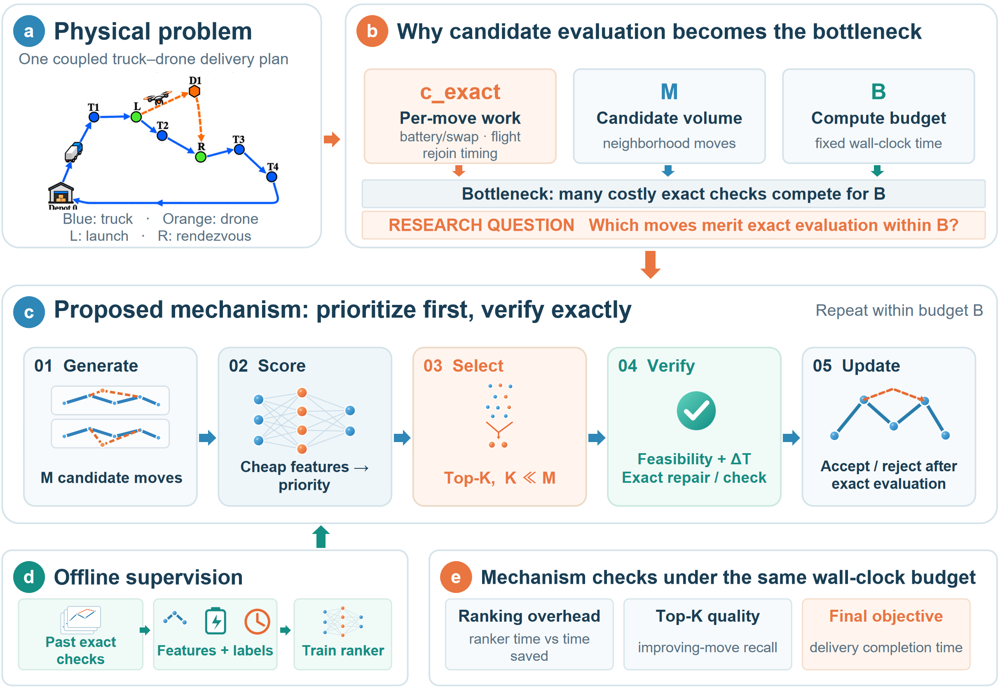
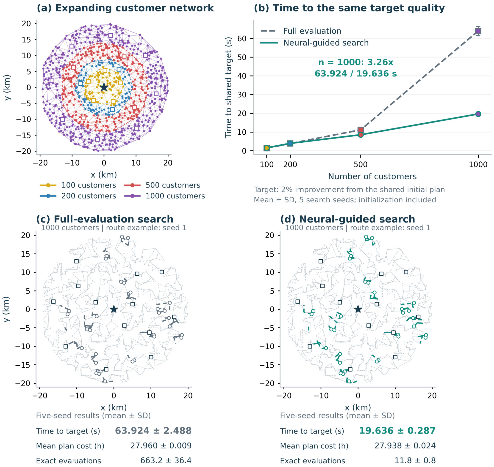
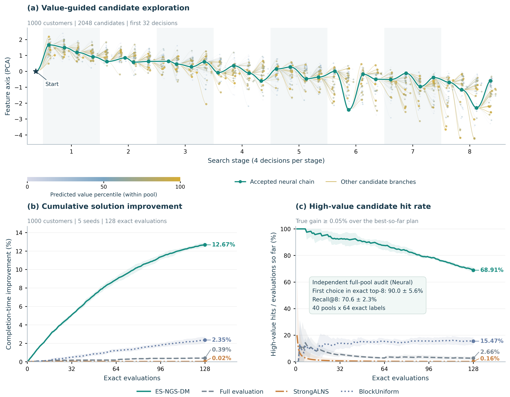

# ES-NGS-DM

**Learning to Prioritize Candidate Evaluations for Large Scale Truck and Drone Delivery**

[Reproduction guide](docs/REPRODUCIBILITY.md) · [Configuration](configs/deployment.json)

ES-NGS-DM learns which local delivery adjustments deserve expensive repair.
A lightweight decision network ranks candidates from route structure, energy
state and synchronization features. Deterministic repair handles battery
swapping and evaluates the actual delivery completion time. Only feasible
improvements update the solution.

## Method



Each round generates up to **64 candidates** from consecutive synchronization
intervals. The released deployment configuration selects **Top-1** for complete
repair. The decision model has **205,253 parameters**. Qwen2.5-1.5B is an optional
offline source of auxiliary preference supervision; it is not loaded by the
online solver. The optimized objective is delivery completion time.

## Results and mechanisms

| Benchmark | Completion time (h) | Truck distance (km) | Charged online time (s) |
|---|---:|---:|---:|
| Synthetic, 30 instances with 1,000 customers | 21.877 ± 1.596 | 763.64 ± 53.75 | 54.773 ± 0.055 |
| LaDe, 8 demand-grounded scenarios | 1.032 ± 1.119 | 40.41 ± 43.86 | 49.637 ± 7.768 |

These are the paper deployment results. Five search seeds are averaged within
each instance, followed by the mean and sample standard deviation across
instances. The fixed lists and ES-NGS-DM run records are included.



On the 1,000-customer scaling case, reaching the common 2% improvement target
takes 19.636 s with neural prioritization versus 63.924 s with full evaluation.



The mechanism experiment connects candidate ranking to optimization gains
after complete repair.

## Included

- Network architecture, prediction heads, decomposition and ranking losses.
- Lightweight student training, Qwen decision-head LoRA training, response-only SFT,
  auxiliary preference export and fixed-epoch controlled training.
- One final paper deployment checkpoint trained on the self-built Synthetic data.
- Frozen Synthetic geometries, eight LaDe scenarios and scenario generation code.
- 480 labeled decision states from 40 Synthetic instances, exact labels, preferences,
  five instance-grouped folds, seeds and hyperparameters.
- Installation instructions, serial benchmark commands, integrity checks and licenses.

## Install

Use Python 3.10 or 3.11 and Julia **1.10.5**. From this directory:

```bash
python -m venv .venv
# Windows: .venv\Scripts\activate
# Linux/macOS: source .venv/bin/activate
python -m pip install -r requirements.txt
python scripts/setup_solver_dependencies.py
julia --project=. -e "using Pkg; Pkg.instantiate()"
```

Install the CUDA build of PyTorch appropriate for your GPU when training Qwen.
The decision model also supports CPU execution. Dependencies are specified in
`Manifest.toml`, `requirements*.txt` and `provenance/environment.json`.

Solver dependencies are downloaded directly from their upstream repositories
into `~/.es_ngs_dm/upstream/`, outside this repository. No TSPDroneICP.jl or
TSPDrone.jl source is bundled. The `ESNGSDM` package contains this project's
energy, synchronization and search extensions. The FI initializer does not
require Concorde, LKH or PyCall. See [dependency setup](docs/DEPENDENCIES.md).

## Quick start

First verify the distribution and rank a saved real candidate pool:

```bash
python scripts/verify_release.py
python -m unittest discover -s tests -v
python scripts/score_candidates.py --top-k 8
```

Run one delivery instance with the released checkpoint:

```bash
julia --project=. scripts/run_case.jl --benchmark synthetic --case n1000_k12_seed20261014_QP --seed 1 --budget 60 --python python
```

Run the two fixed evaluation lists, serially on one machine:

```bash
python scripts/run_benchmark.py --benchmark synthetic
python scripts/run_benchmark.py --benchmark lade
python scripts/summarize_runs.py --input results/paper_synthetic_es_ngs_dm.csv
```

Each run saves its route and a CSV containing completion time, distance,
charged runtime, neural time, repair time, candidate counts and exact repair
calls. The runner verifies the geometry hash, neural execution and final
feasibility. Model startup is reported separately; fresh initialization, search
and final validation are charged. Hardware affects wall-clock search trajectories.

## Train and generate auxiliary preferences

Train the student using the decision states and offline preferences in
`data/training/`:

```bash
python scripts/train.py --stage base
python scripts/train.py --stage exact
python scripts/train.py --stage qwen --teacher-utilities data/training/teacher_utilities_supplement.csv
```

To train the Qwen decision model and export new preferences:

```bash
python -m pip install -r requirements-qwen.txt
python scripts/download_qwen.py
python scripts/train.py --stage teacher
python scripts/train.py --stage export
python scripts/train.py --stage qwen
```

For held-out validation, add `--fold 1` to **every stage**, and repeat for folds
2–5. Train a separate base and teacher within each fold. All-data auxiliary
preferences are for deployment training, not held-out fold evaluation.
See [the full guide](docs/REPRODUCIBILITY.md) for data generation, independent
exact-only validation, legacy response-only SFT and loss details.

## License

Project-owned code is released under the [MIT License](LICENSE). External
dependencies and LaDe-derived scenarios retain their upstream licenses and
attribution in [THIRD_PARTY_NOTICES.md](THIRD_PARTY_NOTICES.md).
